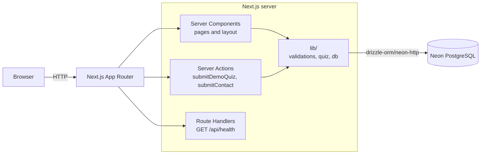
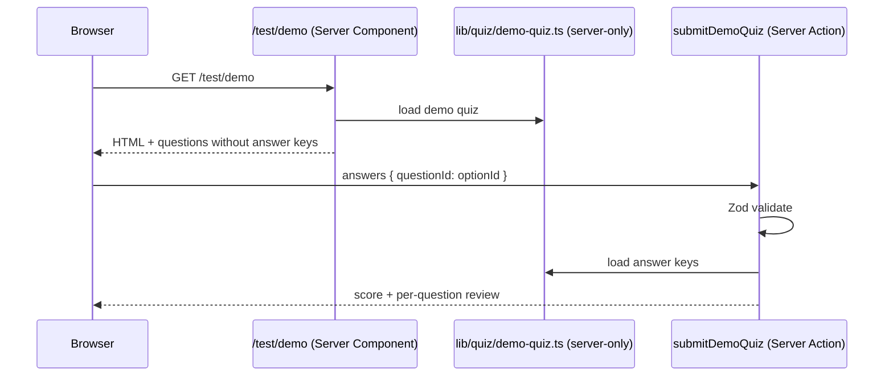
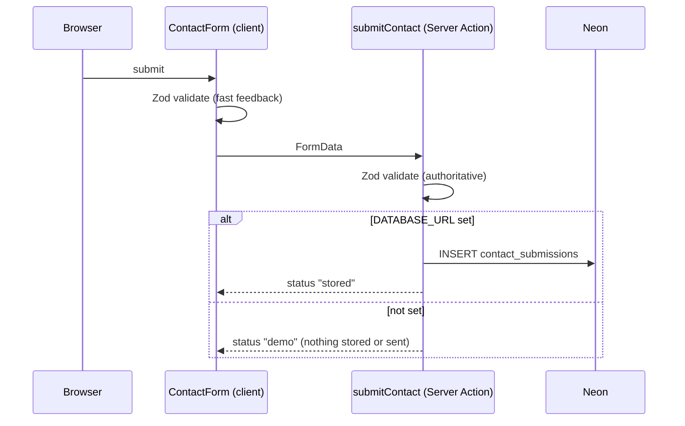

# Architecture

## High-level view

One Next.js application. No separate backend service.



The database edge is optional at runtime. Without `DATABASE_URL` the application runs in
demo mode and only contact persistence is unavailable.

## Responsibilities

| Layer                                                                         | Does                                                                       | Does not                                                   |
| ----------------------------------------------------------------------------- | -------------------------------------------------------------------------- | ---------------------------------------------------------- |
| Server Components (`app/**/page.tsx`, `components/**` without `"use client"`) | Render pages, read server-side data, pass plain props to client components | Hold UI state                                              |
| Client Components (`"use client"`)                                            | Local interaction: menu toggle, quiz answer state, form state              | Import `lib/db`, read secrets, decide scores               |
| Server Actions (`app/**/actions.ts`)                                          | Validate input with Zod, run business logic, write to the database         | Trust client-computed values                               |
| Route Handlers (`app/api/**/route.ts`)                                        | HTTP endpoints for non-UI clients                                          | Duplicate what a Server Action already does for our own UI |
| `lib/`                                                                        | Framework-free logic: schemas, scoring, database access                    | Import React                                               |

## App Router structure

```text
app/
  layout.tsx            root layout: font, metadata, skip link, Navbar, Footer
  globals.css           design tokens and ASCII utilities
  page.tsx              /            Home
  test/page.tsx         /test        catalog, how it works, demo entry
  test/demo/page.tsx    /test/demo   demo quiz shell (server)
  test/demo/actions.ts               submitDemoQuiz
  about/page.tsx        /about
  contact/page.tsx      /contact
  contact/actions.ts                 submitContact
  api/health/route.ts   /api/health
```

`/test/demo` is a static segment so that a future dynamic route `/test/[slug]` can sit
next to it.

## Rendering and caching

`next.config.ts` enables Cache Components and Partial Prefetching (the Next.js 16
generator defaults). Consequences for this codebase:

- All five pages have no request-time data, so the build prerenders them as static.
- A Server Component that reads request data, the database, the clock or random values
  must sit behind `<Suspense>` or use `"use cache"`. The build fails otherwise.
- `GET /api/health` calls `connection()` first so its timestamp is produced per request.
- Do not add `export const dynamic = ...` route config; use the Cache Components model.
- `LayoutProps`, `PageProps` and `RouteContext` are generated types. `pnpm typecheck`
  runs `next typegen` before `tsc` for that reason.

## Server and client boundaries

Client Components in the scaffold, and why each one needs the browser:

| Component                             | Reason                                                    |
| ------------------------------------- | --------------------------------------------------------- |
| `components/layout/nav-links.tsx`     | Mobile menu open state, active link from `usePathname()`  |
| `components/quiz/quiz-runner.tsx`     | Selected answers, current question, pending submit        |
| `components/contact/contact-form.tsx` | Field errors, pending and result state (`useActionState`) |

Everything else is a Server Component. Rules:

- `lib/db/**` and `lib/quiz/demo-quiz.ts` start with `import "server-only"`. Importing
  them from a Client Component fails the build.
- Props crossing the boundary are plain serializable data. Quiz questions cross without
  their answer keys (`toPublicQuiz` strips them).

## API conventions

- Our own UI mutates through Server Actions. They return typed result objects and never
  throw for expected failures (validation, missing database).
- Route Handlers return JSON. Planned error envelope:
  `{ "error": { "code": "string", "message": "string" } }` with a matching HTTP status.
- Internal error details are logged on the server and never returned to the client.
- Contracts are listed in `API.md`.

## Data flow

### Demo quiz



### Contact form



## Database access and ORM strategy

- `lib/db/index.ts` exports `getDb()`. It creates the Drizzle client on first use and
  returns `null` when `DATABASE_URL` is missing. Callers must handle `null`.
- `lib/db/schema.ts` is the single source of truth for tables.
- Queries are written where they are used for now. When a second caller needs the same
  query, move it to `lib/db/queries/<entity>.ts`.
- Details: `DATABASE.md`.

## Validation and error handling

- Zod schemas live in `lib/validations/`. The same schema validates on the client (for
  immediate feedback) and on the server (authoritative).
- Server Actions return a discriminated result: success, validation failure with
  per-field messages, or a generic failure message. Unexpected errors are caught, logged
  with `console.error` and reported to the user as a generic message.
- Form errors are tied to their inputs with `aria-describedby` and `aria-invalid`.

## Environment configuration

| Variable       | Required                  | Used by                                |
| -------------- | ------------------------- | -------------------------------------- |
| `DATABASE_URL` | No (demo mode without it) | `lib/db/index.ts`, `drizzle.config.ts` |

Local values go in `.env.local`, which is ignored by Git. `.env.example` lists the
variable names without values. No variable is prefixed `NEXT_PUBLIC_`; nothing from the
environment is exposed to the browser.

## Security boundaries

- The browser is untrusted. Every Server Action and Route Handler validates its input.
- Database credentials exist only in server environment variables.
- Quiz answer keys stay in server-only modules until the quiz is submitted.
- `/api/health` reports liveness only. It does not report database state, versions or
  host details.
- Not yet covered: rate limiting, spam protection, authentication, security headers
  beyond Next.js defaults. See `ROADMAP.md` Phase 6.

## From demo quiz to database-backed quizzes

The demo was built in the shape of the real system so that only the data source changes.

| Concern            | Demo (now)                             | Database-backed (Phase 2 and 3)                          |
| ------------------ | -------------------------------------- | -------------------------------------------------------- |
| Quiz source        | `lib/quiz/demo-quiz.ts`                | `quizzes`, `questions`, `answer_options` through Drizzle |
| Catalog on `/test` | `lib/quiz/catalog.ts` placeholders     | Query of published quizzes                               |
| Route              | `/test/demo`                           | `/test/[slug]`                                           |
| Public shape       | `PublicQuiz` (no answer keys)          | Same type, built from rows without `is_correct`          |
| Scoring            | `scoreQuiz()` in `lib/quiz/scoring.ts` | Same function, fed from the database                     |
| Persistence        | None                                   | `quiz_attempts` (planned)                                |

Steps for the transition:

1. Seed the tables and add `getPublishedQuizzes()` and `getQuizBySlug()`.
2. Replace `lib/quiz/catalog.ts` with the query; keep `QuizCard`.
3. Add `/test/[slug]` that renders the existing `QuizRunner` with a `PublicQuiz`.
4. Generalize `submitDemoQuiz` into `submitQuiz(slug, answers)` that loads keys from the
   database and reuses `scoreQuiz()`.
5. Remove `/test/demo` or keep it as a no-database fallback.
