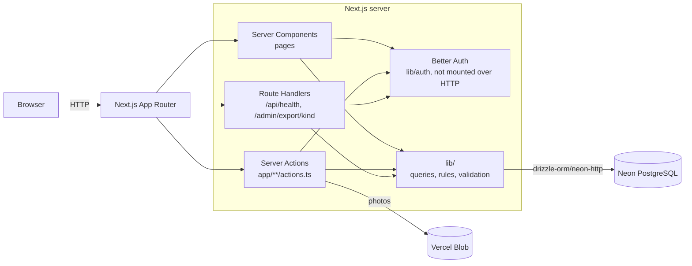
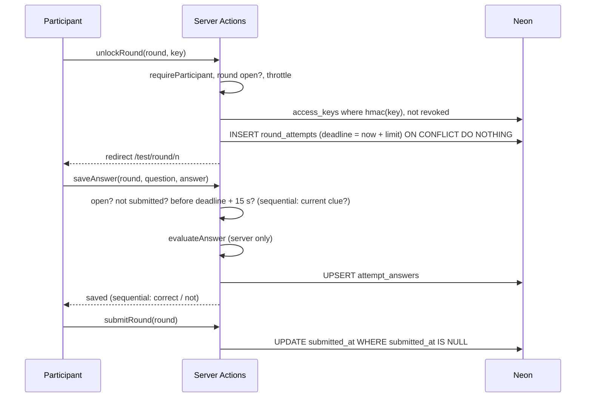

# Architecture

## High-level view

One Next.js application on Vercel. No separate backend service.



## Routes

```text
app/
  layout.tsx                      font, skip link, Navbar, Footer
  page.tsx                        /            Home (cached content)
  contact/                        /contact     Contact Us + submitContact
  test/page.tsx                   /test        login or round dashboard
  test/actions.ts                 loginParticipant, logout, unlockRound, saveAnswer, submitRound
  test/round/[number]/page.tsx    /test/round/1..3
  admin/login/                    /admin/login + adminLogin
  admin/(panel)/layout.tsx        admin shell (requireAdmin)
  admin/(panel)/page.tsx          /admin dashboard
  admin/(panel)/rounds/...        rounds, questions, keys + actions.ts
  admin/(panel)/participants/...  roster + actions.ts
  admin/(panel)/results/          ranking, winners, exports
  admin/(panel)/content/          event info, people + actions.ts
  admin/(panel)/messages/         contact submissions + actions.ts
  admin/(panel)/admins/           admin accounts + actions.ts
  admin/export/[kind]/route.ts    CSV exports
  api/health/route.ts             liveness
  error.tsx, not-found.tsx
```

## Rendering and caching (Cache Components)

- Home and Contact read content through `"use cache"` functions in
  `lib/db/queries/content.ts` tagged `content` / `rounds` (`cacheLife("days")`). They
  prerender into the static shell. Admin actions call `updateTag()` after every content or
  round-settings write, so edits show on the next request.
- Anything that reads the session (`headers()`) sits behind `<Suspense>`: the `/test` gate,
  the round page, the admin layout. Admin pages are a static shell plus streamed content.
- The navbar's `usePathname()` is behind its own Suspense boundary so dynamic routes can
  prerender a shell.
- Participant and admin data is never cached: every read is fresh.

## Authentication and authorization

Better Auth (`lib/auth/server.ts`) with the Drizzle adapter on the same Neon database.
`getAuth()` returns `null` when `DATABASE_URL` or `BETTER_AUTH_SECRET` is missing.

| Who         | How they sign in                                                                                                                                                                                       |
| ----------- | ------------------------------------------------------------------------------------------------------------------------------------------------------------------------------------------------------ |
| Admin       | Email + password (`emailAndPassword`, sign-up disabled). The first by `pnpm admin:create`, more on the panel's Admins page (`auth_users.added_by` set).                                                |
| Participant | Full name + USN via the `participant-sign-in` plugin: checks the roster, creates the Better Auth user on first login, deletes the user's other sessions, creates a session and sets the signed cookie. |

- The Better Auth HTTP handler is **not mounted**. Server Actions call `auth.api.*`
  directly; `nextCookies()` writes the cookies. This removes every unused endpoint
  (sign-up, password reset, ...) from the attack surface.
- Sessions: 12 hours, no sliding refresh, no cookie cache. Every request reads the session
  row, so ending sessions or deleting a participant takes effect immediately.
- `lib/auth/session.ts` is the data access layer: `getViewer()` (per-request `cache`),
  `requireAdmin()`, `requireAdminDb()`, `requireParticipant()`. Every protected page,
  Server Action and Route Handler calls one of them. Layout checks are only UX.
- Server Actions get Next.js's built-in Origin check (CSRF).

## Round flow



- **Deadlines** are enforced on the server. `finalizeExpiredAttempts()` runs before any
  read of attempt state and sets `submitted_at = deadline_at`, `auto_submitted = true`
  for attempts past deadline + 15 s grace. The client countdown only triggers a refresh.
- **Closing a round** submits every open attempt of that round.
- **Answer keys** stay on the server. `toPublicQuestion()` strips `is_correct` and
  `accepted_answers`. Sequential rounds send only solved clues and the current one.
  Non-sequential rounds never reveal correctness. Scores show to participants only when
  an admin enables it.
- **Re-scoring**: saving a question re-evaluates every stored answer to it.
- **Qualification**: an admin can limit round 2 or 3 to the previous round's top N once
  that round is closed. `rankRound()` ranks the previous round alone (score, time taken,
  submission time); `selectQualifiers()` keeps places 1..N, ties on place N included. The
  list is a snapshot in `round_qualifiers` (`rounds.qualifier_limit` = N). `unlockRound`,
  `saveAnswer` and the round page refuse anyone outside it; `isQualified()` is the check.
- **Questions in bulk**: `pnpm questions:import` loads a JSON bank from the gitignored
  `private/` folder (format in `scripts/import-questions.ts`, parsing in
  `lib/rounds/question-bank.ts`), so answer keys never enter Git.

## Results

`getResultsData()` (`lib/db/queries/results.ts`) loads rounds, roster and per-attempt
scores in four queries, then `rankParticipants()` (`lib/results/ranking.ts`, pure, tested)
applies the tie-breaks: total score, rounds submitted, total time, final submission time;
full equality shares the rank. `selectWinners()` takes places 1..N (ties on place N
included, zero scores excluded). `firstFinisher()` is the earliest participant to submit
every round. Dashboard, results page and exports all use the same data.

## Security boundaries

- Browser input is untrusted: every action validates with Zod (`lib/validations/`).
- Throttling (`lib/security/throttle.ts`, table `throttle_events`): participant login 10
  failures / 15 min per USN and 300 per IP (a venue shares one NAT IP); admin login 5 per
  email and IP, 50 per email, 30 per IP; access keys 8 per participant and round per
  10 min; contact form 10 stored messages per IP per hour. `beginAttempt()` writes the
  attempt before counting, so parallel requests cannot slip past a limit together;
  `releaseAttempt()` removes it again when the outcome was not a failure. IP comes from
  `x-forwarded-for`, which Vercel sets.
- Access keys are compared as HMACs; the plaintext is shown once to the admin.
- Photo uploads: 2 MB limit, type sniffed from the file bytes (JPEG, PNG, WebP), stored
  in Vercel Blob under `people/`; `next/image` only allows that host and path.
- CSV exports neutralize spreadsheet formulas.
- Response headers (`next.config.ts`): `Content-Security-Policy` (no nonces, so pages stay
  prerendered: scripts and styles from this site plus inline, images from this site and
  Vercel Blob, no framing, no plugins, forms post only here), `X-Content-Type-Options`,
  `X-Frame-Options: DENY`, `Referrer-Policy`, `Permissions-Policy`; on Vercel also
  `Strict-Transport-Security` and `upgrade-insecure-requests`. No `X-Powered-By`.
- Database: in production the app connects as a role limited to reading and writing rows
  (`docs/DEPLOYMENT.md`, 3.5); migrations use the owner role.
- Errors: logged with `console.error` on the server; clients get generic text.

## Environment

| Variable                | Used by                                                           |
| ----------------------- | ----------------------------------------------------------------- |
| `DATABASE_URL`          | `lib/db/index.ts`, `drizzle.config.ts`, `scripts/create-admin.ts` |
| `BETTER_AUTH_SECRET`    | `lib/auth/server.ts`, `lib/security/access-key-hash.ts`           |
| `BETTER_AUTH_URL`       | `lib/auth/server.ts` (base URL, trusted origin)                   |
| `BLOB_READ_WRITE_TOKEN` | `@vercel/blob` in `app/admin/(panel)/content/actions.ts`          |
| `NEON_FETCH_ENDPOINT`   | `lib/db/index.ts`, local development only                         |
| `VERCEL_*`              | Read by `lib/auth/server.ts` for trusted origins                  |

No variable is prefixed `NEXT_PUBLIC_`.

## Client Components

| Component                             | Why it needs the browser                     |
| ------------------------------------- | -------------------------------------------- |
| `components/layout/nav-links.tsx`     | Mobile menu state, active link               |
| `components/admin/admin-nav.tsx`      | Active admin section                         |
| `components/admin/bar-chart.tsx`      | Dataset tabs, hover/focus readout            |
| `components/ui/action-form.tsx`       | `useActionState`, pending, confirm-to-delete |
| `components/rounds/round-runner.tsx`  | Answers, navigation, autosave, countdown     |
| `components/contact/contact-form.tsx` | Client validation and result state           |
| `app/error.tsx`                       | Error boundary                               |
